# Auditoría UI/UX e integración — Souvenirs Saltillo

Se abrió y capturó el repositorio real en Chromium antes de modificarlo. Después se verificó su build de producción, con una base y credenciales temporales. No hay un hosting publicado confirmado. El producto y fotografía de las capturas finales son **fixtures de prueba**, no artículos reales ni contenido añadido al catálogo del usuario.

## Hallazgos y cambios

| Evidencia inicial | Problema | Cambio aplicado |
| --- | --- | --- |
| Portada escritorio/móvil | Solo tres tarjetas de categorías; sin catálogo, búsqueda ni acción para explorar productos. | Catálogo conectado a productos aprobados, búsqueda, filtros, imágenes, precio y entrega. Estado vacío sin inventar artículos. |
| Portada y código | El texto anunciaba pedido, recepción de logos y entrega desde un pedido que no existía. | Texto ajustado a las funciones actuales. Checkout y logos siguen como desarrollo posterior. |
| Login y rutas | Sin error visible o enlace de retorno; token fijo y respaldo conocido si faltaba configuración. | Error accesible, retorno, sesión aleatoria firmada/persistente con expiración y logout revocable; configuración ausente bloquea acceso. |
| Panel y código | Métricas vacías; formulario enviaba a JSON en vez de permitir editar/publicar. | Métricas reales, vista previa editable, variante explícita, precio sugerido visible y aprobación/borrador. |
| APIs y monitor | Catálogo en memoria y monitor placeholder. | Archivo durable de desarrollo o PostgreSQL, observaciones con estado/fecha, revisión de enlaces principales/alternativos e historial. |
| Revisión final de UI | Errores necesitaban distinguirse de confirmaciones, y el CTA tenía un símbolo sin glifo. | Mensajes rojos con `role=alert`, confirmaciones con `role=status` y CTA de texto claro. |

Se conservaron marca, paleta clara, tipografía y estructura del proyecto. Se intentó el flujo de 12ui; su servicio de autenticación no fue accesible desde el entorno. No se generaron ni se presentaron conceptos de diseño de esa herramienta. Las mejoras se apoyaron en las capturas reales y las funciones existentes.

## Evidencia inicial

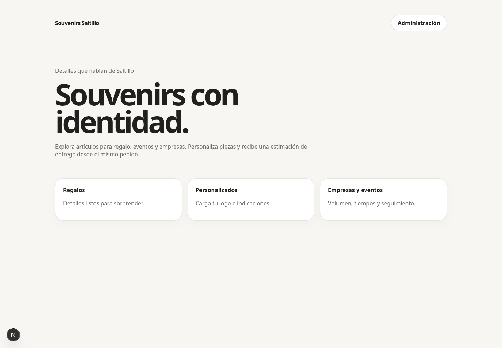

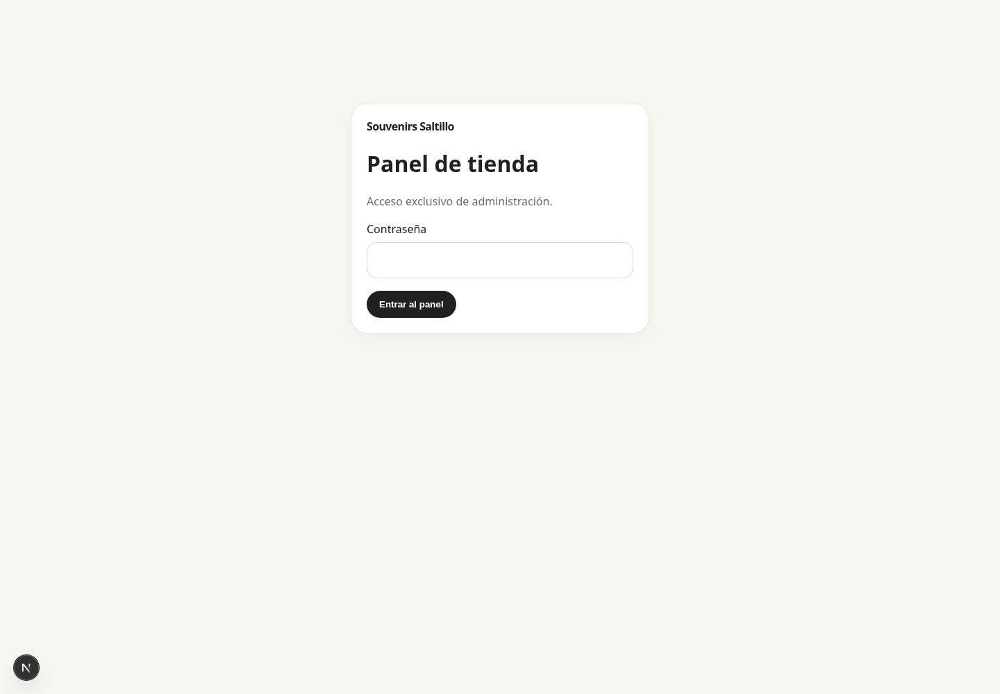

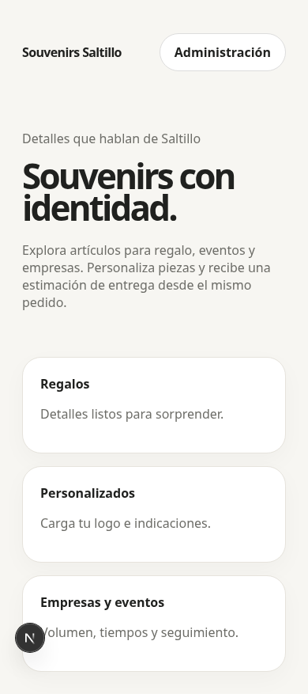

## Flujo final y salud

1. **Tienda sin productos — correcto.** Catálogo y búsqueda visibles, estado vacío y acceso administrativo claro.
2. **Login — correcto.** Error de contraseña y acceso exitoso comprobados; APIs privadas rechazan llamadas sin sesión.
3. **Panel vacío — correcto.** Importación es la siguiente acción y hay avisos claros de búsqueda/programación pendientes.
4. **Enlace inválido — correcto.** URL privada rechazada antes de consultar su contenido; mensaje visible y accesible.
5. **Importación/vista previa — correcto.** Extracción HTTP real sobre JSON-LD sintético; costo 100 MXN, margen bruto 30%, sugerido 143 MXN. Edición, variante y confirmación antes de publicar.
6. **Catálogo administrativo — correcto.** Producto aprobado, costos/precios separados, entrega y revisión de fuente. El dato aprobado conserva el título editado.
7. **Alternativas y revisión — correcto con configuración pendiente.** Se agregó una ficha verificada y otra sin identificadores que requirió confirmación manual. Se abrió su preview sin sustituir silenciosamente al proveedor y se revisaron los enlaces guardados. La búsqueda Brave sigue pendiente de clave.
8. **Catálogo público — correcto.** Imagen cargada, precio/entrega visibles, búsqueda sin resultados y filtros comprobados; costos y fuentes privadas excluidos de la API pública.
9. **Tienda móvil — correcto.** Ancho 390 px sin desbordamiento horizontal; filtros, precio y fotografía legibles.
10. **Panel móvil — correcto.** Formularios y acciones se reorganizan sin desbordamiento horizontal.
11. **Cerrar sesión — correcto, prueba funcional.** Se vuelve al login y reutilizar la cookie anterior devuelve 401. La pantalla coincide con el paso 2, por lo que no se guardó otra captura.

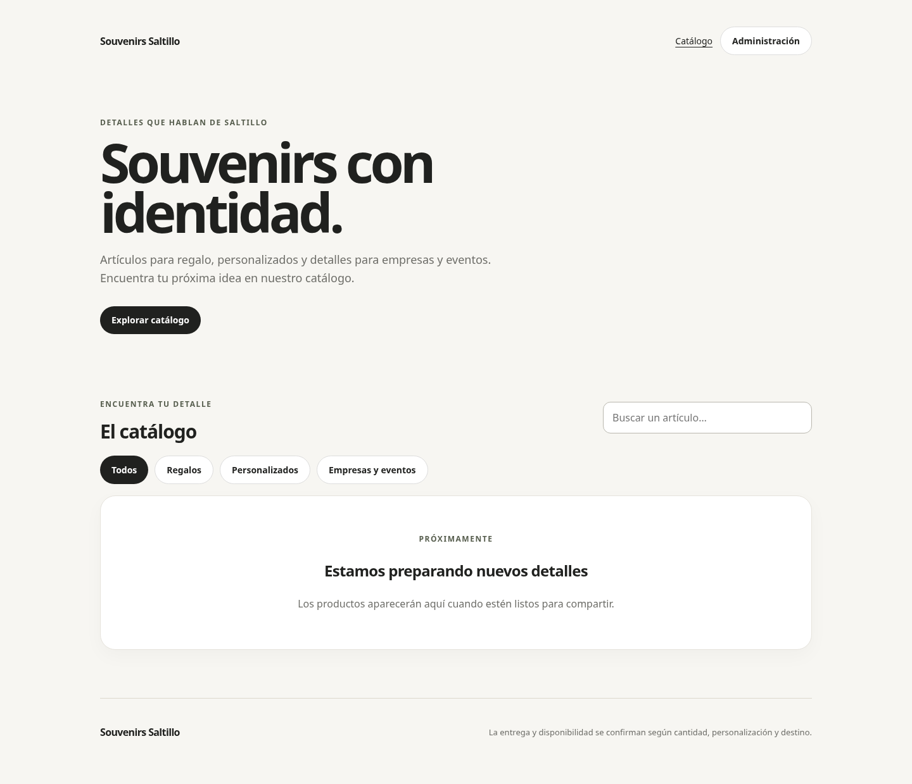

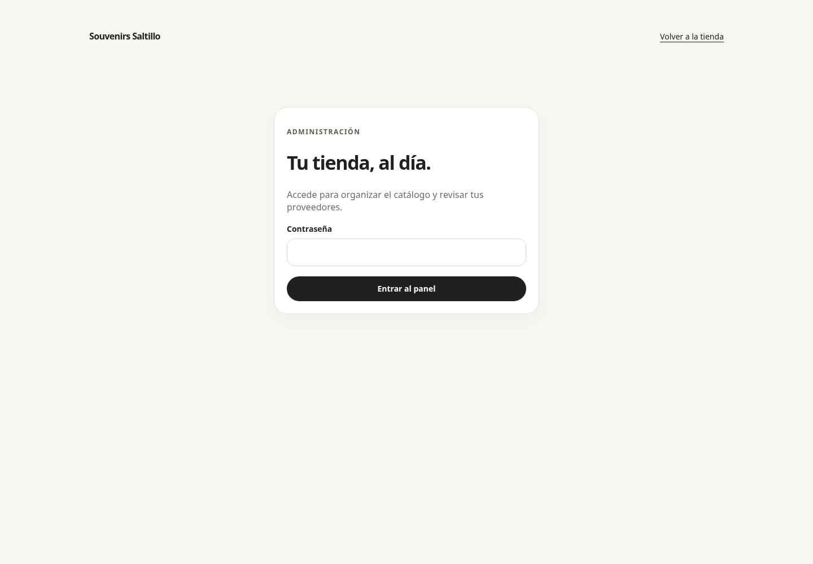

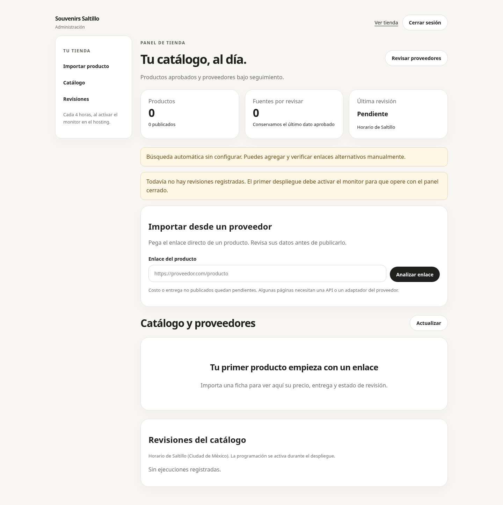

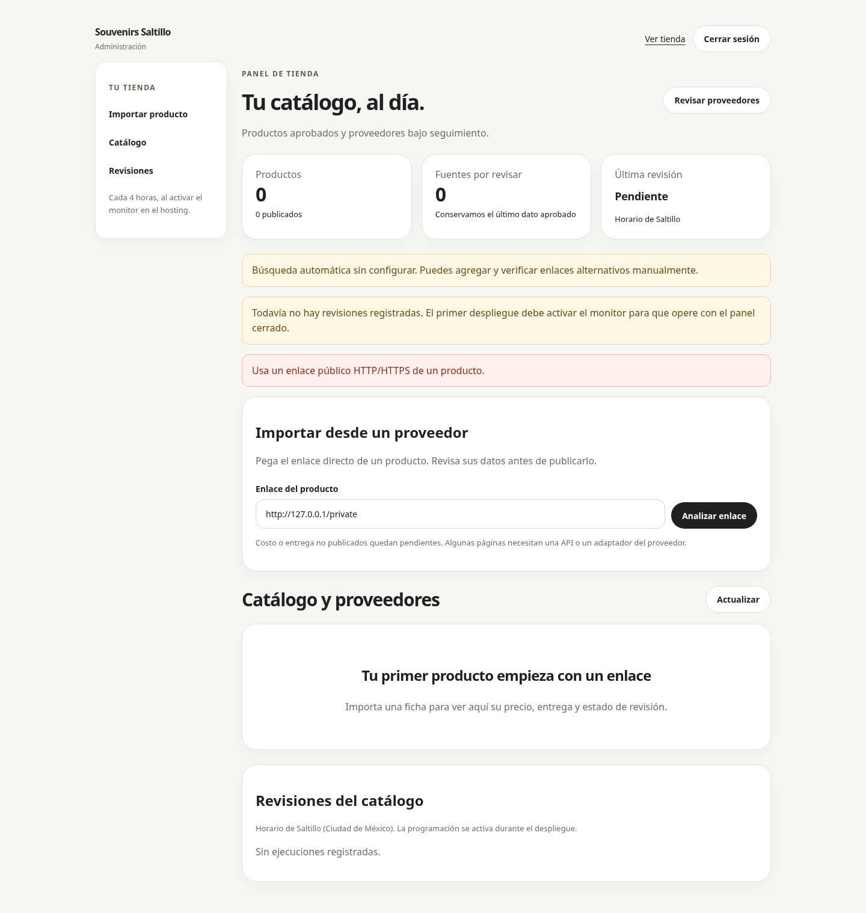

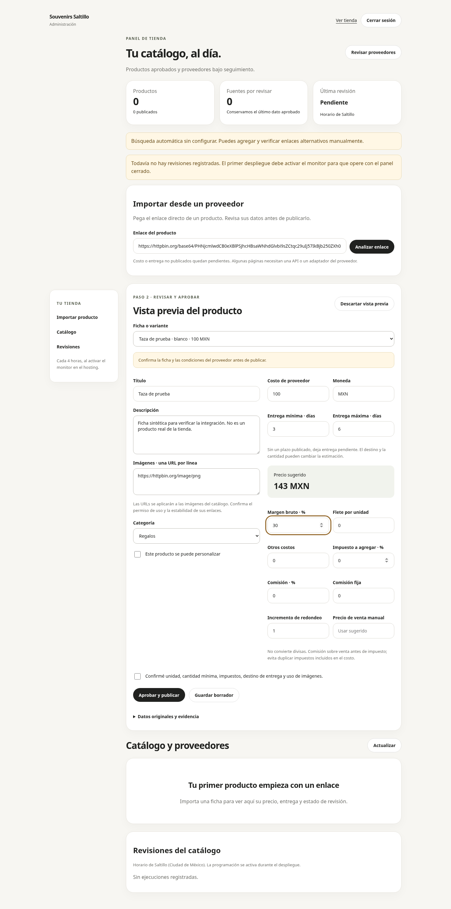

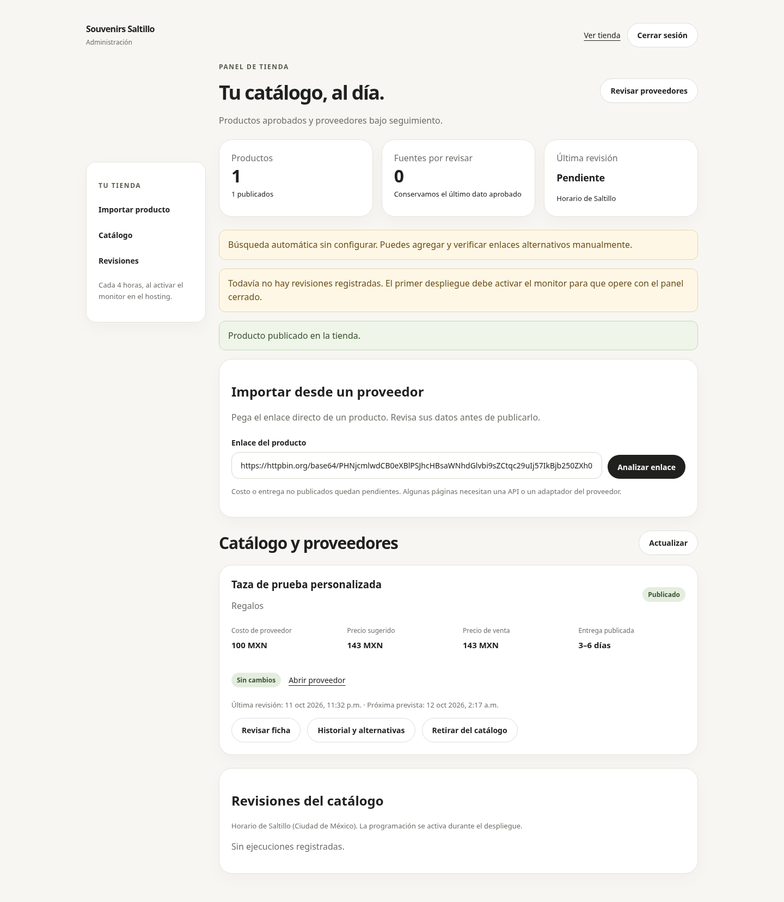

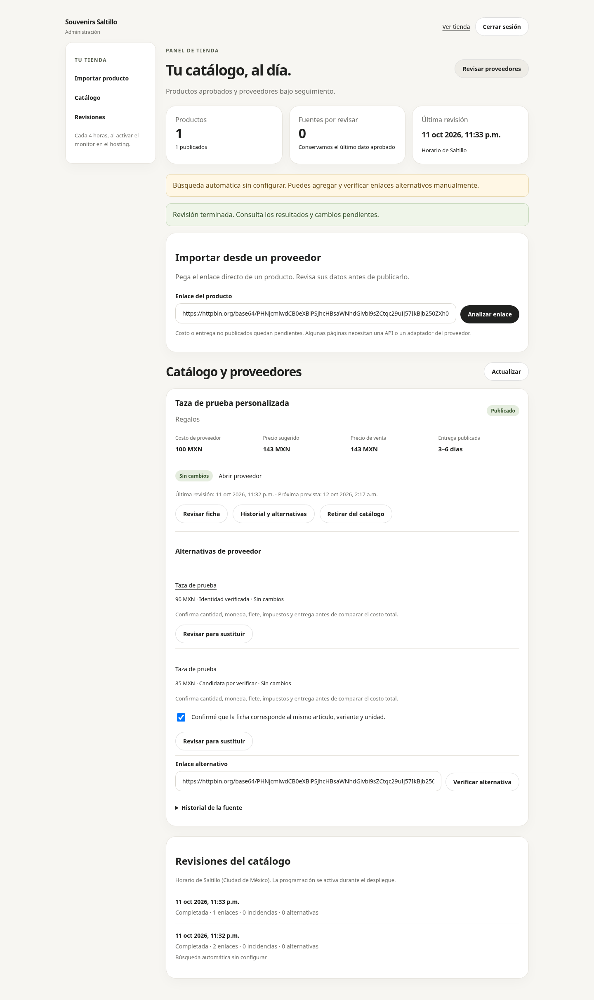

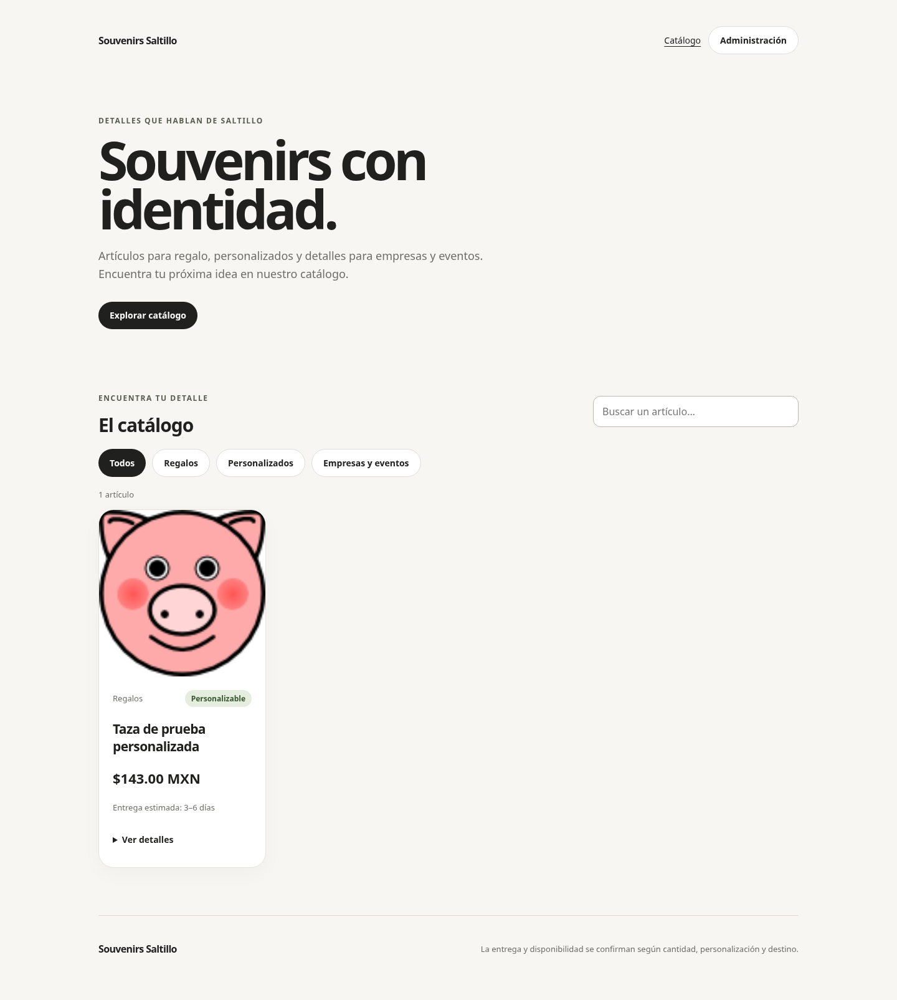

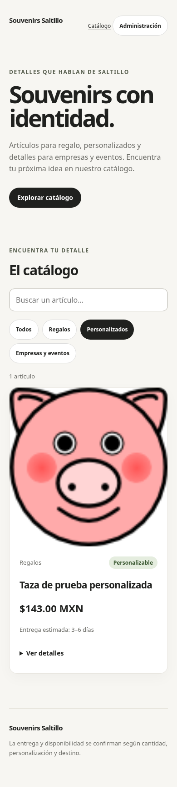

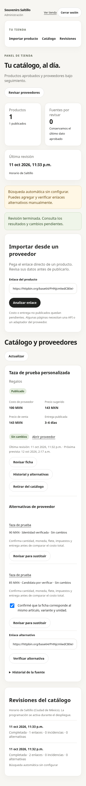

## Accesibilidad y límites

Etiquetas asociadas, foco visible, salto al contenido, campos de contraseña con autocomplete, filtros con `aria-pressed`, estados/errores anunciados, controles de al menos 44 px y ajuste para movimiento reducido. Las pruebas navegan controles por nombre accesible. Capturas y automatización no prueban conformidad WCAG; falta una revisión completa con lector de pantalla y teclado manual.

No se capturó checkout ni carga de logos porque esos flujos aún no existen. No se probó un proveedor comercial del negocio: las páginas de HTTPbin permiten comprobar el transporte y la extracción, pero no prueban compatibilidad con todos los proveedores. Algunos necesitarán una API o adaptador. Imágenes se aplican por URL, sin alojamiento de copias.

## Verificación técnica

Build de producción aprobado; pruebas de unidad/integración, persistencia concurrente en PostgreSQL temporal, importación HTTP real de fixtures, imagen cargada, monitoreo manual de dos fuentes, protección de origen y cierre/replay de sesión comprobados. Sin errores JavaScript ni overflow horizontal en 390 px. La auditoría de dependencias después de actualizar PostCSS reporta cero vulnerabilidades conocidas.

El cron está implementado, pero se activa en producción siguiendo [deployment.md](deployment.md): hosting, base, secrets y `MONITOR_ENABLED=true`. No se afirma monitoreo continuo antes de ese despliegue.
